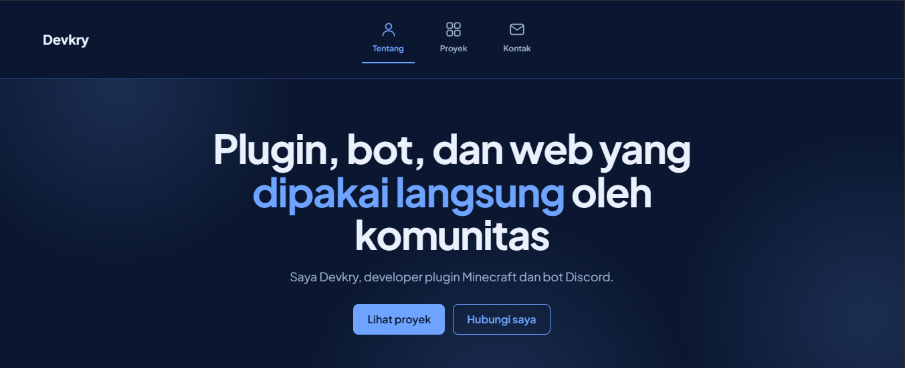

# Devkry Portfolio


Website portofolio pribadi untuk menampilkan plugin Minecraft, bot Discord, dan proyek web. Dibangun dengan HTML, CSS, dan JavaScript murni (tanpa framework), dilengkapi panel admin dan API serverless untuk mengelola daftar proyek langsung dari browser.

**Demo:** https://devkry-portofolio.vercel.app/

<!-- Ganti dengan screenshot asli: simpan gambar di docs/screenshot.png -->


## Fitur

- **Responsif**: tampilan dioptimalkan untuk desktop, tablet, dan HP Android (jendela detail berbentuk *bottom sheet* di layar kecil).
- **Mode terang dan gelap** otomatis mengikuti pengaturan perangkat, dengan palet biru dan putih.
- **Daftar proyek** dengan filter kategori (Plugin, Bot, Web, Lainnya) dan jendela detail untuk setiap proyek.
- **Panel admin**: tambah, edit, dan hapus proyek langsung dari web tanpa mengubah kode. Pengunjung hanya bisa melihat.
- **Login admin dicek di server**, bukan di browser.
- **Animasi halus**: efek mengetik pada judul, elemen muncul saat di-scroll, kartu terangkat saat disentuh, dan latar bergerak. Semua otomatis nonaktif jika pengguna memilih *reduce motion*.
- **Aksesibilitas dasar**: navigasi keyboard, label ARIA, dan indikator fokus yang jelas.

## Teknologi

| Bagian | Teknologi |
| --- | --- |
| Frontend | HTML5, CSS3, JavaScript (vanilla) |
| Backend | Vercel Serverless Functions (Node.js) |
| Penyimpanan | Upstash Redis (REST API) |
| Hosting | Vercel |

## Struktur Proyek

```
portofolio/
├─ index.html          # Struktur halaman
├─ style.css           # Seluruh gaya dan animasi
├─ app.js              # Logika tampilan, login, dan pengelolaan proyek
└─ api/
   └─ projects.js      # API: baca, cek login, dan simpan proyek
```

## Memulai

### Prasyarat

- [Node.js](https://nodejs.org) versi LTS
- Akun [Vercel](https://vercel.com) dan [GitHub](https://github.com)
- [Vercel CLI](https://vercel.com/docs/cli): `npm i -g vercel`

### Menjalankan secara lokal

**Hanya tampilan** (tanpa API): buka `index.html` dengan ekstensi **Live Server** di VS Code, atau jalankan:

```bash
npx serve
```

Pada mode ini daftar proyek akan menampilkan pesan "belum bisa dimuat" dan login admin belum berfungsi, karena API tidak berjalan.

**Lengkap dengan API:**

```bash
# 1. Hubungkan folder ini ke proyek Vercel
vercel login
vercel

# 2. Tambahkan Upstash Redis dari dashboard Vercel (Storage), lalu ambil variabelnya
vercel env pull .env.local

# 3. Jalankan server lokal
vercel dev
```

Buka `http://localhost:3000`.

## Konfigurasi

Atur variabel berikut di **Vercel > Project > Settings > Environment Variables**.

| Variabel | Keterangan | Wajib |
| --- | --- | --- |
| `KV_REST_API_URL` atau `UPSTASH_REDIS_REST_URL` | URL REST Upstash Redis | Ya |
| `KV_REST_API_TOKEN` atau `UPSTASH_REDIS_REST_TOKEN` | Token REST Upstash Redis | Ya |
| `ADMIN_USER` | Username admin (bawaan: `Admin`) | Disarankan |
| `ADMIN_PASS` | Password admin (bawaan: `admin`) | Disarankan |

Variabel Upstash terisi otomatis saat database dihubungkan ke proyek. **Ganti `ADMIN_USER` dan `ADMIN_PASS` dengan nilai yang kuat sebelum dipublikasikan.**

## Deploy ke Vercel

1. Push repo ini ke GitHub.
2. Di Vercel, klik **Add New > Project**, pilih repo, lalu **Deploy**.
3. Tambahkan Upstash Redis dan environment variable di atas.
4. Lakukan **Redeploy** agar variabel terbaca.

## Mengelola Proyek

1. Klik **Login admin** di bagian bawah halaman dan masuk.
2. Klik **+ Tambah proyek**, isi nama, kategori, deskripsi, teknologi (pisahkan dengan koma), dan link.
3. Gunakan tombol **Edit** atau **Hapus** pada kartu proyek untuk mengubah data.

Perubahan langsung tersimpan di database dan terlihat oleh semua pengunjung.

## Referensi API

Base path: `/api/projects`

| Metode | Endpoint | Akses | Keterangan |
| --- | --- | --- | --- |
| `GET` | `/api/projects` | Publik | Mengembalikan daftar proyek |
| `GET` | `/api/projects?check` | Admin | Memeriksa kredensial admin (`200` atau `401`) |
| `PUT` | `/api/projects` | Admin | Mengganti seluruh daftar proyek |

Autentikasi memakai header `Authorization: Basic <base64(username:password)>`.

Contoh data proyek:

```json
{
  "name": "Giveaway Plugin",
  "cat": "Plugin",
  "desc": "Giveaway interaktif dengan GUI hadiah.",
  "tech": ["Java", "Paper/Spigot"],
  "link": "https://github.com/MFXDEV13/nama-repo"
}
```

Batas validasi di server: maksimal 100 proyek, nama maksimal 80 karakter, deskripsi 300 karakter, 10 teknologi per proyek, dan link harus diawali `http://` atau `https://`.

## Kustomisasi

- **Kontak**: ubah array `CONTACTS` di bagian atas `app.js`.
- **Warna dan tema**: ubah variabel CSS di blok `:root` pada `style.css`.
- **Teks hero dan bagian Tentang**: edit langsung di `index.html`.

## Keamanan

- Login diverifikasi di